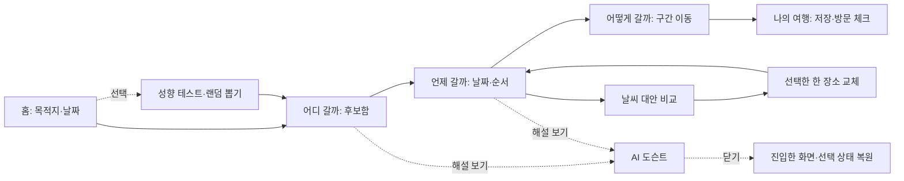

# PinDay — 통합 여정과 정보 구조

2026-10-23 · 이번 문서는 조원들의 아이디어를 묶은 기획·시안 초안이다. 부산 2박 3일은 화면을 연결해 보여주는 예시다. {>>근거: 유형=사용자 제공 자료와 제안; 출처=[현재 대화](codex://threads/01a16659-562a-7a91-8d4e-777f2bfbea55); 위치=신선이·차명근의 Slack 발췌, “저니 맵핑”, “정보 설계 제대로”, “다른 페이지들도”; 연결=PinDay·성향·날씨·도슨트를 통합하고 페이지별 시안을 만드는 요청; 한계=조 전체의 최종 합의·실제 새 기능 구현을 뜻하지 않음<<}

## 한 여행을 끝까지 이어 주는 서비스

**목적지와 날짜 정하기 → 장소 후보 모으기 → 날짜별 일정 배치 → 이동 확인 → 날씨 대안 비교 → 저장·재방문**을 중심 여정으로 둔다. 성향 테스트·랜덤 뽑기는 시작을 돕는 선택 경로, 도슨트는 탐색·일정에서 선택한 장소를 이해하는 보조 경로다. {>>근거: 유형=제안; 출처=현재 사용자 제공 PinDay 목표와 여정 매핑 요청; 위치=탐색→일정→지도 흐름 및 도슨트 추가; 연결=부가 기능 때문에 계획 문맥을 잃지 않는 순서를 제안; 한계=사용성 검증 전<<}

{>>근거: 유형=설계 제안; 출처=사용자 여섯 메뉴 및 travel_frontend 독립 검토; 위치=후보/일정 분리·한 장소 교체·도슨트 복귀 규칙; 대상=위 다이어그램; 연결=중심 여정과 선택 경로, 보조 기능 복귀를 시각화; 한계=구현·전환 테스트 결과가 아님<<}

## 여정 매핑

| 단계 | 사용자 생각·목표 | 현재 결정과 주 행동 | 성공 신호·다음 전환 |
|---|---|---|---|
| 시작 | 어디로 언제 갈까? | 목적지·날짜 입력 → 여행 시작 | 같은 여행 헤더 생성 → 탐색 |
| 발견 | 어떤 곳이 나에게 맞을까? | 카테고리·동네 필터 → 후보 저장 | 후보 수 증가, 검색과 스크롤 유지 |
| 배치 | 이곳을 며칠째 방문할까? | 후보 → 날짜 선택 → 방문 순서 | 해당 DAY 카드·지도 번호 동기화 |
| 이동 | 이 두 장소 사이를 어떻게 갈까? | 일정 구간·교통수단 선택 | 실제 제공되는 구간 정보/외부 길찾기 |
| 조정 | 비가 오면 이 장소 대신 어디로? | 원래 장소와 대안 비교 → 교체 확정 | 한 장소만 변경, DAY·시각·다른 장소 유지 |
| 이해 | 이 동네에 어떤 이야기가 있지? | 선택 장소의 해설·근거 열기 | 원문 확인, 닫으면 원래 선택·화면 복원 |
| 실행 | 계획을 다시 보고 방문 체크하자 | 저장 여행 열기·방문 완료 체크 | 브라우저 재진입 시 계획 복원 |
{>>근거: 유형=제안; 출처=사용자 제공 PinDay 기능·도슨트 제안·독립 IA 검토; 위치=핵심 플로우와 전환 위험; 대상=위 표 전체; 연결=각 단계의 목표·결정·피드백을 대응; 한계=실제 사용자 행동 관찰 결과가 아닌 검증할 가설<<}

## 페이지 정보 구조

모든 페이지는 같은 **여행 ID·목적지·여행 기간·선택 DAY·후보 수·일정 수**를 공유한다. ‘후보 5곳’과 ‘일정 3곳’은 다른 상태로 표시한다. {>>근거: 유형=설계 제안; 출처=현재 정보 설계 요청과 travel_frontend 독립 검토; 위치=공통 TripID·후보와 일정의 혼동; 연결=메뉴 이동으로 여행 정보를 재입력하거나 계획이 분리되는 문제를 막는 구조; 한계=효과 검증 전<<}

| 메뉴·화면 | 하위 정보 | 가장 중요한 행동 | 다음 화면에 전달할 것 |
|---|---|---|---|
| **홈** | 목적지·날짜, 선택형 테스트·랜덤 뽑기, 진행 중 여행 | 여행 시작 / 이어가기 | 현재 여행 |
| **여행 성향 테스트** | 한 질문씩, 진행 상태, 건너뛰기, 유형 결과 | 답변 → 취향으로 탐색 | 취향 필터, 기존 일정은 보존 |
| **어디 갈까?** | 관광지·맛집·카페·쇼핑, 동네 필터, 장소 상세, 후보함 | 후보함에 저장 | 장소 ID·저장 상태 |
| **언제 갈까?** | DAY별 카드, 미배치 후보, 방문 순서·메모, 날짜별/동네별 지도 | 이 날짜에 추가 / 순서 변경 | 날짜별 방문 항목 |
| **어떻게 갈까?** | 일정 구간, 대중교통·자동차·도보, 정보 출처 | 선택 구간 길찾기 | 출발·도착 장소·수단, 원래 DAY |
| **날씨가 안 좋으면?** | 여행 시간대 예보, 영향받는 장소, 실내/야외 대안 | 비교 → 이 장소로 교체 | 교체할 방문 항목과 장소 ID |
| **AI 도슨트** | 선택 장소/지역, 역사·문화, 최근 소식, 근거 원문 | 해설 보기 → 원래 일정 | 같은 장소·진입 화면·스크롤 |
{>>근거: 유형=설계 제안; 출처=사용자가 제시한 여섯 메뉴·성향 테스트·차명근 도슨트; 위치=현재 요청 전체; 대상=위 표; 연결=각 페이지의 소유 정보·주 행동·전달 상태를 분리; 한계=테스트 문항·유형은 예시 초안, 심리 진단이 아님<<}

**나의 여행**은 공통 저장·재방문 진입점으로 둔다. 지도는 탐색과 일정의 보기 방식이며 별도 복사된 계획을 만들지 않는다. 모바일은 홈·탐색·일정·나의 여행을 우선하고 이동·날씨·도슨트는 더보기와 해당 장소/구간의 문맥 버튼으로 연결한다. {>>근거: 유형=제안; 출처=PinDay의 나의 여행·반응형 웹 방향과 현재 정보 설계 요청; 위치=사용자 제공 주요 기능·개발 방향; 연결=공통 저장 정보와 좁은 화면의 접근 경로를 제안; 한계=이번 이미지는 데스크톱 시안이며 모바일 사용성은 별도 확인 필요<<}

**후보함 수는 저장한 전체 장소의 수**다. 이번 시안은 후보함 5곳 중 3곳이 일정에 배치됐고 2곳이 미배치인 상태다. 일정에 추가해도 후보 저장을 해제하지 않으며, 미배치 여부는 방문 항목 참조로 계산한다. {>>근거: 유형=설계 제안과 시안 정합성; 출처=현재 정보 설계 요청과 PinDay 시안; 위치=후보 5곳·일정 3곳·미배치 2곳; 연결=전체 저장과 미배치 집계의 의미를 일치시킴; 한계=설명용 예시 수치<<}

## 헷갈리지 않게 나눌 행동

| 행동 | 변경 대상 | 보존할 정보 |
|---|---|---|
| 후보함에 저장 | 여행의 저장 장소 목록 | 날짜·순서·기존 일정 |
| 일정에 추가 | 고른 날짜의 방문 항목 | 후보함·다른 날짜 |
| 방문 순서 변경 | 해당 DAY 순서·인접 이동 구간 | 장소·날짜·메모 |
| 날씨 대안 교체 | 선택한 한 항목·그 앞뒤 이동 정보 | 일차·시각·다른 방문 항목, 원본 후보 |
| 랜덤 다시 뽑기 | 제안 카드 | 이미 저장한 후보·일정 |
| 테스트 다시 답하기 | 취향과 이후 추천 기준 | 이미 배치한 일정 |
| 도슨트 열기/닫기 | 보조 해설 패널 | 원래 페이지·DAY·마커·스크롤 |
{>>근거: 유형=설계 제안; 출처=travel_frontend 독립 IA 검토; 위치=후보/일정 혼동·기존 계획 소실·부가 기능 이탈의 세 위험; 대상=위 행동 표; 연결=버튼 이름과 변경 효과를 대응; 한계=실제 이벤트 처리·회귀 검사는 구현 단계<<}

## 도슨트의 위치와 내용

**지도·장소·일정에서 같은 장소 ID로 ‘해설 보기’를 연다.** 전역 도슨트 메뉴도 현재 선택을 이어받고, 선택이 없으면 부산의 장소나 동네부터 고르게 한다. 초기에는 동네 필터·마커 선택을 사용하고, 행정구역 경계 클릭은 공간 데이터가 준비되면 확장한다. {>>근거: 유형=제안; 출처=차명근의 지역 클릭 도슨트와 선이님의 부산 여행 제안; 위치=사용자 제공 발췌; 연결=전국 별도 지도 앱을 부산 여행 문맥의 지역 해설로 통합; 한계=행정구역 경계 데이터·상호작용은 미연동<<}

패널 정보 순서는 **장소·지역명 → 지역 이야기/최근 소식 탭 → 짧은 해설 → 근거 원문·발행일 → 후보 저장/일정 복귀**다. 역사 근거와 최근 뉴스의 시점을 구분하고, 출처가 없으면 확인할 자료가 없다고 표시한다. 생성된 문장을 실제 기사나 검증된 역사처럼 꾸미지 않는다. {>>근거: 유형=설계 제안; 출처=사용자 제공 도슨트의 근거 자료·최근 이슈·출처 링크 조건; 위치=차명근 15:46 발췌; 연결=도슨트의 정보 계층과 근거 표시를 정의; 한계=실제 데이터·검색·설명 모델 연동은 미구현<<}

## 공통 데이터와 갱신

| 정보 | 핵심 내용 | 연결 기준 |
|---|---|---|
| 여행 | 목적지·기간·취향·이동수단 | 모든 화면이 같은 여행 ID |
| 장소 | 공급자 ID·주소·좌표·분류·출처·실내 여부 확인 상태 | 지도·후보·일정·해설이 같은 장소 참조 |
| 후보 | 여행 ID·장소 ID·저장 여부 | 저장한 전체 장소, 일정 미배치 여부는 별도 계산 |
| 방문 항목 | 날짜·순서·장소·메모·방문 체크 | 날짜 지도·일정 표의 단일 원천 |
| 이동 구간 | 앞/뒤 방문 항목·수단·출처·조회 상태 | 교체·재정렬 시 영향 구간만 다시 확인 |
| 날씨 | 좌표·실제 예보 시각·강수·기온·조회 시각 | 여행 날짜와 대조, 미확정/실패 구분 |
| 해설 | 장소/지역 ID·역사 근거·뉴스 출처·발행/생성 시각 | 선택 문맥 유지, 원문 추적 |
{>>근거: 유형=설계 제안; 출처=현재 정보 설계 요청·독립 IA 검토; 위치=공통 상태 보존과 출처 시점 구분; 대상=위 정보 표; 연결=페이지별로 복사된 독립 상태를 만들지 않는 연결 구조; 한계=현재 구현 스키마 전체를 설명하는 표는 아님<<}

## API와 구현 범위

공통 구조는 사용자가 승인한 **React + Vite / FastAPI / 카카오 지도**를 유지한다. 카카오 로컬로 장소를 찾고 관광 자료로 콘텐츠를 보완한다. 교통은 일정의 구간별 외부 길찾기부터 연결하고, 날씨·도슨트는 별도 공급자 연동과 근거 확인을 거친다. {>>근거: 유형=결정과 제안; 출처=현재 대화의 apptech 구조 승인, [지도 가이드](https://apis.map.kakao.com/web/guide/), [로컬 API](https://developers.kakao.com/docs/ko/local/dev-guide), [TourAPI](https://www.data.go.kr/data/15101578/openapi.do); 위치=React/FastAPI 진행 승인·각 공식 기능 범위; 연결=도슨트 제안의 Leaflet/Flask를 자동으로 새 기술 지시로 해석하지 않고 공통 베이스에 기능 통합; 한계=교통·도슨트의 실제 계정·API 승인 상태는 확인하지 않음<<}

방문 순서 선은 도로 경로가 아니며, 검증된 경로 응답이 없으면 임의의 이동 시간·요금을 넣지 않는다. 날씨는 현재 날씨와 여행 날짜 예보를 구분한다. 실내 여부가 확인된 후보가 없으면 비를 피할 수 있다고 보장하지 않는다. {>>근거: 유형=설계 제안; 출처=사용자 제공 PinDay 핵심 API 설명, [예보 문서](https://openweathermap.org/api/forecast5); 위치=경로 별도 API 조건·예보 실제 시각; 연결=부족한 데이터를 정교한 숫자나 확정 설명으로 채우지 않도록 시안/구현 범위를 구분; 한계=외부 연동·예외 동작 검증 전<<}

## 일곱 화면 보기

[화면별 여정 뷰어](index.html)에서 주 행동·다음 전환·유지되는 정보를 함께 확인할 수 있다. 이미지를 실제 서비스의 연동 결과로 해석하지 않는다. {>>근거: 유형=디자인 산출물; 출처=[뷰어](index.html), 아래 개별 이미지; 위치=2026-10-23 built-in image_gen 생성 시안; 연결=사용자가 요청한 각 페이지를 같은 여행 문맥으로 검토; 한계=사진·날씨·이동·해설·성향 결과는 기획 예시<<}

| 화면 | 시안 |
|---|---|
| 홈 | [여행 시작과 선택 경로](pinday-home-v3.png) |
| 나의 여행 테스트 | [취향 결과에서 장소 탐색으로](pinday-taste-v2.png) |
| 어디 갈까? | [지도 탐색과 후보함](pinday-explore-v2.png) |
| 언제 갈까? | [날짜별 일정과 문맥 해설](pinday-planner-docent-v3.png) |
| 어떻게 갈까? | [구간별 이동 확인](pinday-transport-v2.png) |
| 날씨 대안 | [한 장소 교체 비교](pinday-weather-v2.png) |
| AI 도슨트 | [장소 이야기와 근거](pinday-docent-v2.png) |
{>>근거: 유형=산출물 목록; 출처=각 행의 이미지, [프롬프트](image-prompts-pages-v2.txt), [홈·일정 프롬프트](image-prompts-v2.txt); 위치=현재 페이지별 시안 작업; 대상=위 목록; 연결=정보 구조와 실제 생성한 화면의 대응; 한계=이미지는 조작 가능한 제품 화면이 아님<<}

## 여정 검증 과제

**부산 여행 만들기 → 두 장소 후보 저장 → DAY 1에 배치 → 두 장소 사이 이동 확인 → 한 장소의 날씨 대안 비교 → 해설 열고 닫기 → 원래 일정 복원**을 실제로 시켜 본다. 각 단계에서 목적지·기간·후보·선택 DAY가 유지되는지, 다음 행동을 설명 없이 찾을 수 있는지 관찰한다. {>>근거: 유형=검증 계획; 출처=현재 여정 매핑 요청·PinDay 성공 기준; 위치=검색·날짜 배치·지도 확인; 연결=정보 구조가 실제 과업을 이어주는지 확인할 시나리오; 한계=통합 새 여정은 아직 테스트 전<<}

현재 [map-5](https://github.com/ohzoohzo/map-5)의 관광 검색·지도·수동 일정·브라우저 저장 베이스와 [통과한 CI](https://github.com/ohzoohzo/map-5/actions/runs/39912850274)는 별도 실행 근거다. 이번 산출물은 **일곱 화면의 기획 시안**이며, 테스트·랜덤·교통·날씨·도슨트 기능 구현 완료를 뜻하지 않는다. {>>근거: 유형=실행 범위; 출처=위 레포·CI와 현재 초안 요청; 위치=2026-10-23 completed/success 직접 확인 및 화면 기획 요청; 연결=실제로 검증한 기존 코드와 새 디자인을 구분; 한계=공개 배포·새 외부 연동 미완료<<}
