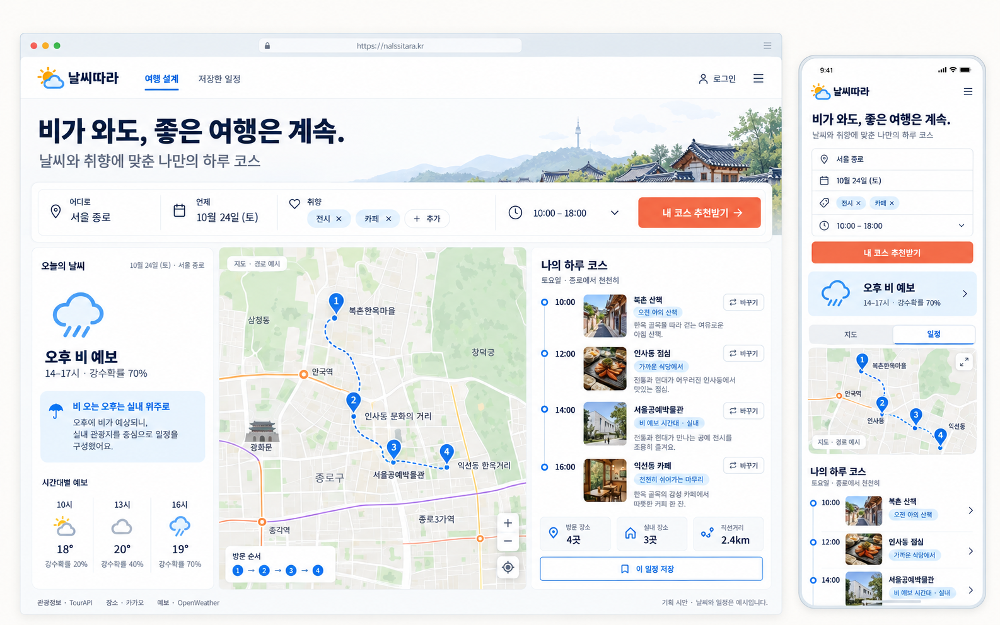

# 날씨따라 — 여행 설계 기획 초안

작성일: 2026-10-23. 서비스명과 아래 기능 범위는 제안이며, 실제 연동 상태와 구분한다. {>>근거: 유형=제안; 출처=현재 대화; 위치=사용자의 “카카오 지도 api 랑 open api 랑 날씨 api … 여행 계획 추천”, “기획 내용이랑 시안 이미지 생성”; 연결=지도·관광·날씨를 결합한 여행 추천 기획 요청; 한계=서비스명과 상세 기능은 아직 조의 최종 합의가 아님<<}

## 시안 이미지

{>>근거: 유형=생성 산출물; 출처=[이미지](travel-concept-v1.png), [프롬프트](image-prompt.txt); 위치=2026-10-23 built-in image_gen 신규 ui-mockup 생성; 연결=입력→시간대별 날씨→지도→코스 편집 화면을 데스크톱·모바일로 시각화; 한계=화면 속 날씨·장소 일정·도메인·거리·사진은 시안 예시이며 실제 조회값·공개 서비스 주소가 아님<<}

## 한 문장

**지역·날짜·취향을 고르면, 여행 날짜의 날씨와 장소 간 거리를 고려해 3~5곳의 하루 코스를 제안하고 지도에서 바꿔 볼 수 있는 서비스.** {>>근거: 유형=제안; 출처=현재 대화; 위치=여행 계획 추천 서비스 기획 요청; 연결=첫 버전을 한 지역·당일 코스로 좁힌 제품 가설; 한계=추천 품질과 적정 장소 수는 사용자 검증 전<<}

## 누구의 어떤 문제를 풀까

첫 대상은 이번 주말 국내에서 당일 여행을 하려는 사람이다. “어디를 갈지”뿐 아니라 “비가 오면 무엇으로 바꾸고 어떤 순서로 돌지”를 한 화면에서 결정하게 한다. 핵심 질문은 **“이번 주말 이 지역에서, 날씨에 맞춰 어떤 순서로 놀면 좋을까?”**다. {>>근거: 유형=제안; 출처=현재 대화; 위치=여행 설계·날씨 API 활용 요청; 연결=날씨로 인한 일정 재작성과 장소 간 이동 부담을 제품 문제로 정의; 한계=목표 사용자 인터뷰로 확인한 수요가 아닌 기획 가설<<}

## 사용 흐름

1. **여행 조건 입력:** 지역, 여행 날짜, 시작·종료 시간, 출발 장소, 취향(자연·전시·맛집·여유), 실내 선호 여부를 고른다.
2. **코스 제안:** 후보 장소와 해당 날짜 예보를 조회해 오전·점심·오후·카페 등 3~5개 방문 슬롯을 제안한다.
3. **지도와 이유 확인:** 방문 순서를 지도에서 보고, 장소마다 추천 이유와 날씨 정보를 확인한다.
4. **원하는 부분만 변경:** 장소 교체·삭제·순서 변경 시 지도와 일정 요약이 함께 바뀐다.
5. **저장:** 첫 버전은 이 브라우저에 일정 저장·복원, 공유 링크는 다음 단계로 둔다.
{>>근거: 유형=제안; 출처=현재 대화 및 [D08 워크북](/Users/yun-yeowon/Downloads/D08_1023.html:349); 위치=조 미션의 질문·필터·지도·숫자·표 동기화 조건; 대상=위 1~5의 전체 흐름; 연결=수업의 지도 서비스 조건을 여행 일정 편집 흐름으로 구체화; 한계=자동 추천과 날씨는 현재 구현 전, 현재 베이스는 수동 일정 저장 구조<<}

## API가 맡는 역할

| 데이터/도구 | 역할 | 준비와 범위 |
|---|---|---|
| 한국관광공사 TourAPI | 지역·좌표 주변·키워드로 여행 후보를 찾고 설명·사진·상세 정보를 확보 | 무료, 활용신청과 인증키 필요. 개발 단계 자동승인·운영 단계 심의승인. {>>근거: 유형=사실; 출처=[공식 API 안내](https://www.data.go.kr/data/15101578/openapi.do); 위치=상세 및 제공정보·이용 조건; 확인=2026-10-23; 연결=지역/위치/키워드/상세·이미지 제공과 무료·신청 조건; 한계=실제 계정 승인 및 호출은 미실행<<} |
| 카카오 로컬 API | 장소 좌표 확인, 식당·카페 등 주변 장소 검색 | FastAPI에서 REST 키로 호출. {>>근거: 유형=사실과 설계; 출처=[카카오 공식 문서](https://developers.kakao.com/docs/ko/local/dev-guide); 위치=주소로 좌표 변환·키워드로 장소 검색·카테고리로 장소 검색; 확인=2026-10-23; 연결=위치 및 장소 검색 기능과 서버에서 REST 키를 보관하는 설계<<} |
| 카카오 지도 JavaScript SDK | 지도·번호 마커·방문 순서 표시 | 브라우저에는 JavaScript 키만 사용, 실제 접속 도메인 등록. {>>근거: 유형=사실과 설계; 출처=[지도 공식 가이드](https://apis.map.kakao.com/web/guide/); 위치=준비하기·시작하기; 확인=2026-10-23; 연결=JS 키와 SDK 도메인 조건; 한계=지도 선은 방문 순서 시각화이며 도로 경로 계산을 뜻하지 않음<<} |
| OpenWeather 5 Day / 3 Hour | 여행 시간대의 기온·강수확률·날씨 상태 조회 | 최대 5일·3시간 단위 예보. 무료 플랜에 포함되며 인증키 필요. {>>근거: 유형=사실; 출처=[공식 예보 문서](https://openweathermap.org/api/forecast5), [요금 안내](https://openweathermap.org/price); 위치=Product concept·API call·Free Weather API access; 확인=2026-10-23; 연결=예보 기간·간격·강수확률·무료 플랜 포함 여부; 한계=5일 밖 날짜의 예보를 제공한다고 약속하지 않음<<} |

FastAPI가 위 데이터를 합쳐 추천 결과를 만들고, React가 지도와 일정으로 표현한다. 첫 버전에서 LLM은 필수로 두지 않는다. 필요하면 검증된 장소 ID와 추천 근거만 받아 설명을 다듬는 역할로 추가한다. {>>근거: 유형=제안; 출처=현재 대화; 위치=사용자가 React+FastAPI 구성에 “응 그렇게해봐”; 연결=이미 승인된 기술 구성에서 추천 책임을 서버로 모으고 장소 사실 생성과 설명 작성을 구분하는 제안; 한계=LLM 연동은 미구현<<}

## 추천 기준

- **후보 수집:** 실제 관광 API 결과 중 선택 지역에 있고 좌표가 확인된 장소를 사용한다. 식사·카페 후보는 카카오 검색으로 보완한다.
- **취향 반영:** 사용자가 고른 테마에 맞는 분류·상세정보를 우선한다. 근거가 부족한 태그는 확인 필요로 남긴다.
- **날씨 반영:** 강수확률 60% 이상인 시간대에는 실내로 확인된 후보를 우선하는 정책으로 시작한다. 이 값은 조정 가능한 초기 정책이며 예보 정확도를 뜻하지 않는다.
- **실내/실외 확인:** 관광지·문화시설이라는 큰 분류만으로 실내라고 단정하지 않는다. 상세정보나 검수된 태그가 없으면 날씨 적합성 미확인으로 표시한다.
- **동선 정리:** 가까운 후보를 묶고 중복 방문을 피한다. 첫 버전의 거리 값은 좌표로 계산한 직선거리이며 실제 교통 소요시간으로 표시하지 않는다.
- **추천 이유:** “비 예보 시간대의 실내 후보”, “선택한 전시 취향”, “앞 장소와 가까움”처럼 실제 입력과 데이터로 설명할 수 있는 근거만 표시한다.
{>>근거: 유형=제안; 출처=현재 대화, [OpenWeather 예보 필드](https://openweathermap.org/api/forecast5); 위치=list.pop 강수확률 필드와 여행 추천 요청; 대상=위 추천 정책 6개; 연결=취향·예보·위치를 결합한 검증 가능한 규칙 기반 추천 제안; 한계=60%·정렬 정책의 효과는 미측정, 관광 API가 실내 여부나 영업 상태를 일괄 보장하지 않음<<}

## 화면 시안의 구성

**상단:** 서비스명, “날씨에 맞춰, 가까운 곳부터”, 지역·날짜·취향 입력과 ‘내 코스 추천받기’ 버튼. **왼쪽:** 여행 조건과 시간대별 날씨. **가운데:** 카카오 지도와 번호 마커. **오른쪽:** 오전→점심→오후→카페 일정 카드, 추천 이유, ‘장소 바꾸기’. 하단에는 장소 수·확인된 실내 장소 수·직선거리 합계의 숫자 3개, **시간·장소·분류·주소·출처를 비교하는 일정 표**, 출처·기준시각을 둔다. 모바일은 조건→지도→일정 순서로 한 열에 배치한다. {>>근거: 유형=제안; 출처=현재 이미지 시안 요청 및 [워크북](/Users/yun-yeowon/Downloads/D08_1023.html:353); 위치=지도·숫자 3개·표·출처 조건; 연결=추천과 편집을 동시에 볼 수 있는 화면 구성; 한계=시안 속 장소·날씨·시각은 설명용 예시이며 실제 API 결과나 완료 화면이 아님; 비평=travel_backend 독립 검토에서 표 요구 누락을 발견하여 일정 표를 추가함<<}

## 오늘 만들 첫 버전

**한 지역·하루·3~5곳, 지역/날짜/취향 입력, 후보 검색, 날씨에 맞춘 코스 제안, 지도 표시, 장소 교체, 브라우저 저장**을 목표로 한다. 예약·결제·교통편 예매·숙박 최저가 비교·정확한 교통 소요시간·다중 사용자 공동 편집은 이후 기능으로 둔다. {>>근거: 유형=제안; 출처=현재 대화; 위치=API 조합 여행 추천 기획 요청; 연결=수업 시간 안에 검증할 범위를 제한한 MVP 제안; 한계=조 일정과 API 키 준비 상태에 따른 조정 필요<<}

**검증:** 추천된 장소가 실제 API 결과인지, 선택한 날짜의 예보를 썼는지, 지역·날짜·장소 교체 시 지도와 일정이 일치하는지 확인한다. 짝 조 사용자에게 “서울에서 내일 비를 피하며 전시와 카페를 즐길 코스를 만들어 보세요”를 주고 코스를 결정하는 데 걸린 시간과 수정 이유를 기록한다. {>>근거: 유형=제안; 출처=[워크북](/Users/yun-yeowon/Downloads/D08_1023.html:361); 위치=짝 조 테스트·30초 질문 목표; 연결=조의 수업 검증 방식을 여행 추천 시나리오로 바꾼 계획; 한계=테스트 수행 전이며 30초 달성 실적을 의미하지 않음<<}

## 예외 상황과 현재 상태

예보 범위는 API가 실제 반환한 시각을 **한국 시간(KST)**으로 바꿔 판단한다. 범위 밖 날짜는 **‘날씨 미확정’**, API 실패는 **‘날씨를 불러오지 못했어요’**, 영업시간 정보가 없으면 **‘방문 전 운영시간 확인’**으로 구분한다. 실내로 확인된 후보가 부족하면 **‘실내 후보 확인 필요’**라고 알리고 비를 피하는 코스를 보장하지 않는다. 날씨가 실패해도 관광지 목록과 수동 일정 편집은 사용할 수 있게 한다. {>>근거: 유형=제안; 출처=[OpenWeather 예보 범위](https://openweathermap.org/api/forecast5)와 현재 여행 추천 기획; 위치=5일 예보 범위·list.dt UTC 시각·여행 날짜 기반 제안; 연결=데이터가 없는 상태를 추측한 날씨·영업 상태로 채우지 않는 제품 동작; 한계=예외 처리 구현과 사용자 검증 전; 비평=travel_backend 독립 검토의 시각 범위·실내 보장 주의점을 반영<<}

현재 레포는 [ohzoohzo/map-5](https://github.com/ohzoohzo/map-5). 로컬에서 관광 CSV 892행 정제와 FastAPI 카탈로그·카카오 검색을 작성했고, 백엔드 테스트 31개가 통과했다. React 베이스의 엄격 TypeScript·Bazel 빌드와 E2E 5개가 통과했다. 추가로 모바일 알림이 버튼을 덮지 않도록 일반 문서 흐름으로 옮겼으며 최종 화면 검사를 수행한다. **TourAPI·OpenWeather·자동 코스 추천은 아직 미연동**이다. {>>근거: 유형=실행 상태; 출처=[백엔드 코드](/Users/yun-yeowon/workspace/map-5/backend/app/main.py), [테스트](/Users/yun-yeowon/workspace/map-5/backend/tests/test_backend.py), [정제 결과](/Users/yun-yeowon/workspace/map-5/data/clean.csv); 위치=2026-10-23 현재 작업 및 backend 에이전트 검증 결과; 연결=로컬 작성·검증 범위와 앞으로 연결할 범위를 구분; 한계=시점 기준 스냅샷이며 공개 배포 완료를 의미하지 않음<<}
